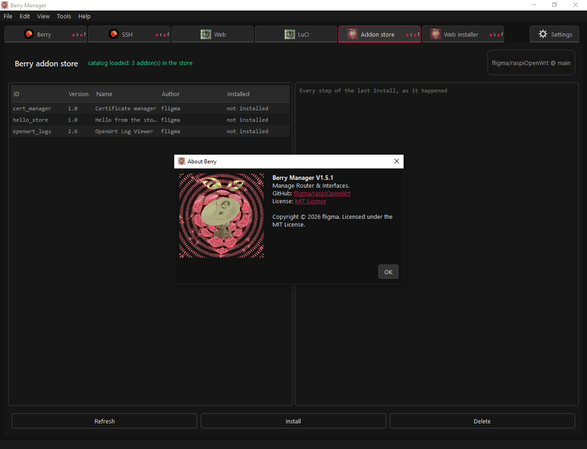

# Berry Manager & the Berry dashboard

Everything for running a Raspberry Pi as an OpenWrt router and looking after it
from your desktop. The repository holds two products that work together:

| Part | Lives in | What it is |
| --- | --- | --- |
| **Berry dashboard** | `src/www_rasconf` | A small web UI that runs *on the device*: Python CGI pages served by uhttpd, with interface status, wireless clients, temperature, load, traffic and storage, behind a PIN login |
| **Berry Manager** | `src/berry_manager` | A PyQt6 desktop app that manages the device over SSH/SFTP: named profiles, a real terminal, file browsing, embedded web tabs, and an addon system |

Berry Manager is the manager; the dashboard is one of the things it manages.
The **Berry web dashboard** addon in the store (`berry_web`) can install the
dashboard onto a device straight from this repository, set uhttpd up for it and
paint the page in the theme the manager is wearing - no checkout needed on the
machine doing the installing.

## The device side: the Berry dashboard

`src/www_rasconf` is the tree that is deployed to the device's
`/www_berry`, served by uhttpd on port 8989:

- `cgi-bin/index.py` - the CGI entry point; `?action=api` answers with the
  same data as JSON for scripts and for the manager's own views.
- `cgi-bin/` siblings (`auth.py`, `store.py`, `sysinfo.py`, `netinfo.py`,
  `pages.py`) - PIN/session auth, saved settings, system and network info,
  and the HTML templates.
- `cgi-bin/hash.file` - the SHA-256 of the PIN. It belongs to the device:
  installers never overwrite it, and it is created on first run if missing.

Setup commands, the uhttpd configuration and the page/API layout are in
[src/www_rasconf/README.md](src/www_rasconf/README.md). A ready-to-flash
OpenWrt image for the Raspberry Pi 3/Zero 2 (the bcm2710 factory ext4 image)
sits in `fresh_install/`.

## The desktop side: Berry Manager

`src/berry_manager` is the whole application - sixteen small modules, one
entry point (`berry_manager.py`) and no build step to run it:

```sh
cd src/berry_manager
pip install -r requirements.txt
python berry_manager.py
```

What it gives you:

- **Profiles** in the File menu - every profile (host, port, keys, and all
  settings) lives in its own `{profile}.json`, so switching devices switches
  everything; passwords go to the operating system's credential store, never
  to a file.
- **SSH terminal** - a real xterm-style emulator: `nano`, `htop` and colour
  prompts work, quick-command buttons sit above it, and a reboot watch
  reconnects when the device comes back.
- **Files over SFTP**, custom embedded browser tabs (including the dashboard
  itself, with a self-signed-certificate switch), interface zoom, and
  **themes** - the whole look of the window is one `themes/<name>.theme` JSON
  file, and the app writes `default.theme` into that folder the first time it
  runs, so there is always something to edit and always something to fall back
  on. View > Theme and Settings > Appearance choose which one is worn; the
  bundled Theme Manager makes them, and a colour wheel is there for anything
  coloured.
- **Addons** - the app's extension system, described below.

Packaging is one PyInstaller command, and the GitHub workflow
(`.github/workflows/build.yml`) runs it for Windows and Linux on a push to
`main` that changes the app or the addons shipped inside it - after running
every addon's test script. A push that only brings an addon for the **store**
just rewrites the store's catalog and builds no executables, and a push that
touches neither (the web dashboard, the pictures, a README) does nothing at
all. The artifact is `berry_manager(.exe)` plus an empty `addons` folder for
your own drop-ins.
The full documentation - modules, every settings key, HTTPS certificate
handling, the build - is in
[src/berry_manager/README.md](src/berry_manager/README.md).

## The addon API

An addon is a file you drop in the `addons` folder beside the program; Berry
Manager gives it a tab, a menu, the device connection and its own config file.
The same Python file runs imported into the app, or compiled into its own
program that the app talks to over stdin/stdout with one JSON object per line
- so addons can be written in any language, and a Python addon can be built
into an executable without changing its code.

Everything an addon needs arrives through one object:

```python
def init(api):
    api.tabs.add_tab("My tool", spec={...})       # declare a page, no Qt
    api.device.run("uptime")                      # SSH on the profile's host
    api.events.on("ssh_connected", on_connected)  # the app's own events
    api.log("ready")                              # the shared log
```

`api.device` (SSH/SFTP, threads and all), `api.tabs` (own tabs, web tabs,
widgets built from declarative specs, tab icons, sub-pages added while the tab
is open, terminal leaves on connections of their own), `api.theme` (the looks the
window is drawn from, read and written as files), `api.ui` (dialogs, menus,
secret inputs, a colour wheel, a file box, the clipboard), `api.config`/`api.settings` (per-installation JSON file and
per-profile notes), `api.schedule`, `api.peers` (addons talking to each
other) and `api.session`/`api.paths` make up the full surface - each is
documented with examples in the app README's **Addons** chapter.

An addon's tab mark costs no code either: one name, `<id>icon.png`, looked for
first in an `assets/<id>/` folder beside the addon's own file - so
`addon.store/assets/cert_manager/cert_managericon.png` for a store addon's
source, `addons/assets/multi_ssh/multi_sshicon.png` for a program dropped in
beside the `.exe` - and then in the program's own `src/berry_manager/assets`,
which is where the four bundled addons' pictures live. A square PNG is what the
bar draws. With no file anywhere the tab wears the SVG the addon sends, and a
tab that sends nothing wears `assets/defaulttabicon.png`.

Four addons ship inside the program, and each has a Settings page of its own
named after it:

- **Berry** - the file manager: device and local pages in one tab, with a
  syntax-coloured editor.
- **Berry addon store** - the store itself: reads the catalog published in
  `addon.store` at the root of the repository, then downloads, tests and
  compiles any addon listed there into a program of its own in `addons`.
- **Berry Manager update** - checks the repository's releases, and downloads,
  verifies and swaps in a newer build, with the previous file kept as a way
  back.
- **Theme Manager** - makes and edits the `.theme` files: every look on disk
  with its author, an editor that works on one draft at a time (colours by
  their groups, the tab bar by its knobs, or the JSON direct), the templates,
  and a reference of every `api.theme` call read off the running app.

Everything else comes from that store - **Berry web dashboard** (the device-side
page above, installed over SFTP with its uhttpd settings driven by `uci`),
**Certificate manager**, **OpenWrt
Log Viewer**, **OpenWrt Package Manager**, **Multi SSH** (any number of SSH
sessions in sub-tabs, each on a connection of its own) and **Password manager**
(logins in one encrypted file on this computer, unlocked for the session, with a
copied password taken back off the clipboard after the seconds you set) - and an
install is not a
second-class addon. The store writes an `addons/<id>.json` manifest beside the program it
built (its name, version, author and the transports it needs) and seeds its
settings form, so the moment it is switched on it has a tab of its own on the
store's **Addon manager** page - enable switch, restart, its own SSH and SFTP
gates, an own-connection option where the author left the choice open, its
settings form and a Desktop shortcut, its caption drawn grey while it is off -
while the addons that came inside the program each
keep a page of their own in Settings. Deleting it from the store takes the
program and that manifest back, and
takes `addons/_data/<id>` with it unless you say otherwise - the switch on the
store's Settings page for every delete, the check box beside the source at the
top of the tab for this one - so a reinstall keeps your settings whenever that
is what you asked for.

The **Addon Dev** tab (Tools > Addon Dev) works on addon files themselves:
read the manifest and source, run a generated test script against a recording
stub, and compile an addon into its own program. Each addon keeps its settings
in `addons/_data/<id>/config.json`, so a hand edit is always possible and the
app reads it back without a restart.

## Repository layout

```
src/www_rasconf/     the web dashboard deployed to /www_berry on the device
src/berry_manager/   Berry Manager: the desktop app and its bundled addons
addon.store/         the addons the store publishes, with their pictures and tests
themes.store/        the themes the Theme Manager's store publishes
fresh_install/       OpenWrt factory image for a fresh Pi
media/               logo and screenshots
.github/workflows/   the Windows + Linux build pipeline
Bkup/                older backups of the manager
```

## License

MIT - see [LICENSE](LICENSE).
